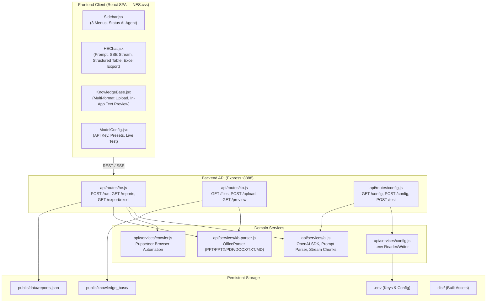
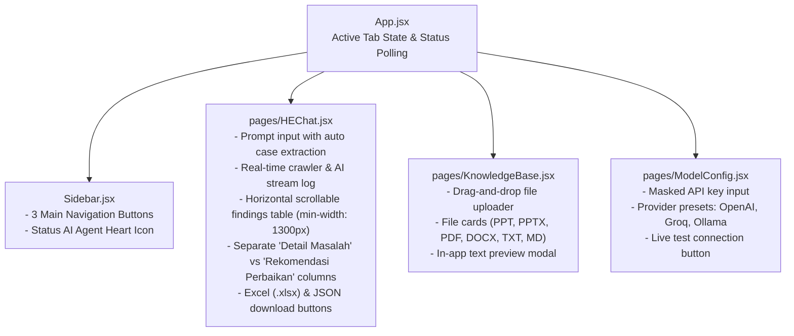
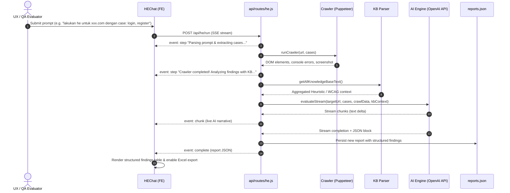

# HE SUITE — Codegraph
> Generated: 2026-10-27T13:30:00+07:00 | Source: live codebase scan

---

## 1. System Architecture (v2.0 — branch `mini`)

---

## 2. Component Dependency & Touchpoints

---

## 3. Data Flow: Heuristic Evaluation Run

---

## 4. Technology Stack & Packages

| Component | Technology / Library | Purpose |
|---|---|---|
| **Frontend Framework** | React 18 + Vite | Single Page Application shell |
| **8-Bit Theme** | `nes.css` | Authentic Nintendo/Arcade components, buttons, containers |
| **Typography** | `Press Start 2P` + `Inter` | 8-bit titles/badges + crystal clear readability for table text |
| **Icons** | `nes-icon` + `lucide-react` | Retro icons & UI utilities |
| **Backend Framework** | Node.js + Express | REST API, SSE Streaming, Static file serving |
| **AI Client** | `openai` SDK | Universal OpenAI-compatible API connector (OpenAI, Groq, Ollama, etc.) |
| **Document Parser** | `officeparser` | Text extraction from PPT, PPTX, PDF, DOCX, TXT, MD |
| **Automation** | Puppeteer | Headless crawling, interactive elements & error capture |
| **Report Export** | `xlsx` | Native Excel (.xlsx) workbook generator |
| **Configuration** | `dotenv` | Safe `.env` file management for API keys |
